# Data lineage

<!-- Generated by `python -m governance.lineage docs` from governance/lineage.py. Do not edit by hand: CI fails if this file is out of date. -->

Lineage of every table this project writes, from origin to the dashboards.
The registry in [governance/lineage.py](../governance/lineage.py) is the single
source of truth: this page is generated from it, CI checks it against the column
lists in the loaders and `CREATE TABLE` statements, and each pipeline run emits it
as [OpenLineage](https://openlineage.io) events to `logs/lineage/openlineage.jsonl`
(and to Marquez or any OpenLineage backend when `OPENLINEAGE_URL` is set).

## Table-level lineage

Cylinders are tables this project writes; rounded boxes are the jobs between them.
The Delta maintenance jobs (compaction, snapshot expiry, vacuum) read and write the
same tables without changing any row, so they are listed below instead of drawn.

```mermaid
flowchart LR
  subgraph s_api["Source"]
    d_api_products["/products"]
  end
  subgraph s_xcom["Airflow hand-offs"]
    d_xcom_raw_products["extract.products"]
    d_xcom_validated_products["validate.validated_products"]
  end
  subgraph s_kafka["Kafka (batch)"]
    d_kafka_validated_products["validated_products"]
  end
  subgraph s_file["Local replay queue"]
    d_file_failed_products["failed_records/failed_products.json"]
  end
  subgraph s_databricks["Databricks Unity Catalog"]
    d_dbx_bronze_products[("bronze_products")]
    d_dbx_silver_products[("silver_products")]
    d_dbx_dim_category[("dim_category")]
    d_dbx_fact_products[("fact_products")]
    d_dbx_gold_product_summary[("gold_product_summary")]
  end
  subgraph s_stream_kafka["Kafka (streaming)"]
    d_kafka_user_events["user-events"]
  end
  subgraph s_lakehouse["Delta Lake lakehouse"]
    d_delta_user_events[("user_events")]
    d_delta_user_events_rejected[("user_events_rejected")]
    d_delta_products[("products")]
  end
  subgraph s_trino["Trino serving layer"]
    d_trino_user_events["user_events"]
    d_trino_user_events_rejected["user_events_rejected"]
    d_trino_products["products"]
    d_trino_v_events_by_type[("v_events_by_type")]
    d_trino_v_events_by_user[("v_events_by_user")]
    d_trino_v_events_per_minute[("v_events_per_minute")]
    d_trino_v_product_activity[("v_product_activity")]
  end
  subgraph s_dashboard["Dashboards"]
    d_dash_streamlit["streamlit_app"]
    d_dash_metabase["metabase/User Events - Trino Lakehouse"]
    d_dash_powerbi["powerbi/User_Event_Analytics_Trino.pbix"]
  end
  j_fakestore_pipeline_extract(["fakestore_pipeline.extract"]):::job
  d_api_products --> j_fakestore_pipeline_extract
  j_fakestore_pipeline_extract --> d_xcom_raw_products
  j_fakestore_pipeline_validate(["fakestore_pipeline.validate"]):::job
  d_xcom_raw_products --> j_fakestore_pipeline_validate
  j_fakestore_pipeline_validate --> d_xcom_validated_products
  j_fakestore_pipeline_send_to_kafka(["fakestore_pipeline.send_to_kafka"]):::job
  d_xcom_validated_products --> j_fakestore_pipeline_send_to_kafka
  j_fakestore_pipeline_send_to_kafka --> d_kafka_validated_products
  j_fakestore_pipeline_replay_failed(["fakestore_pipeline.replay_failed"]):::job
  d_file_failed_products --> j_fakestore_pipeline_replay_failed
  j_fakestore_pipeline_replay_failed --> d_kafka_validated_products
  j_kafka_consumer_load_bronze_silver(["kafka_consumer.load_bronze_silver"]):::job
  d_kafka_validated_products --> j_kafka_consumer_load_bronze_silver
  j_kafka_consumer_load_bronze_silver --> d_dbx_bronze_products
  j_kafka_consumer_load_bronze_silver --> d_dbx_silver_products
  j_kafka_consumer_load_bronze_silver --> d_file_failed_products
  j_kafka_consumer_promote_to_warehouse(["kafka_consumer.promote_to_warehouse"]):::job
  d_kafka_validated_products --> j_kafka_consumer_promote_to_warehouse
  d_dbx_silver_products --> j_kafka_consumer_promote_to_warehouse
  d_dbx_dim_category --> j_kafka_consumer_promote_to_warehouse
  j_kafka_consumer_promote_to_warehouse --> d_dbx_dim_category
  j_kafka_consumer_promote_to_warehouse --> d_dbx_fact_products
  j_kafka_consumer_promote_to_warehouse --> d_dbx_gold_product_summary
  j_streaming_kafka_to_delta(["streaming.kafka_to_delta"]):::job
  d_kafka_user_events --> j_streaming_kafka_to_delta
  j_streaming_kafka_to_delta --> d_delta_user_events
  j_streaming_kafka_to_delta --> d_delta_user_events_rejected
  j_streaming_load_products(["streaming.load_products"]):::job
  d_api_products --> j_streaming_load_products
  j_streaming_load_products --> d_delta_products
  j_serving_register_tables(["serving.register_tables"]):::job
  d_delta_user_events --> j_serving_register_tables
  d_delta_user_events_rejected --> j_serving_register_tables
  j_serving_register_tables --> d_trino_user_events
  j_serving_register_tables --> d_trino_user_events_rejected
  j_serving_register_products(["serving.register_products"]):::job
  d_delta_products --> j_serving_register_products
  j_serving_register_products --> d_trino_products
  j_serving_views(["serving.views"]):::job
  d_trino_user_events --> j_serving_views
  d_trino_products --> j_serving_views
  j_serving_views --> d_trino_v_events_by_type
  j_serving_views --> d_trino_v_events_by_user
  j_serving_views --> d_trino_v_events_per_minute
  j_serving_views --> d_trino_v_product_activity
  j_dashboard_streamlit(["dashboard.streamlit"]):::job
  d_dbx_bronze_products --> j_dashboard_streamlit
  d_dbx_silver_products --> j_dashboard_streamlit
  d_dbx_gold_product_summary --> j_dashboard_streamlit
  d_dbx_dim_category --> j_dashboard_streamlit
  d_dbx_fact_products --> j_dashboard_streamlit
  d_file_failed_products --> j_dashboard_streamlit
  d_trino_v_product_activity --> j_dashboard_streamlit
  j_dashboard_streamlit --> d_dash_streamlit
  j_dashboard_metabase(["dashboard.metabase"]):::job
  d_trino_user_events --> j_dashboard_metabase
  d_trino_user_events_rejected --> j_dashboard_metabase
  d_trino_v_events_by_type --> j_dashboard_metabase
  d_trino_v_product_activity --> j_dashboard_metabase
  j_dashboard_metabase --> d_dash_metabase
  j_dashboard_powerbi(["dashboard.powerbi"]):::job
  d_trino_user_events --> j_dashboard_powerbi
  d_trino_user_events_rejected --> j_dashboard_powerbi
  j_dashboard_powerbi --> d_dash_powerbi
  classDef job fill:#1a2438,stroke:#3987e5,color:#f1f5f9
```

## Final tables

| Table | Layer | Upstream (nearest first) | Downstream | PII | Retention |
|---|---|---|---|---|---|
| `fakestore_catalog.etl_project.bronze_products` | bronze | `validated_products`, `validate.validated_products`, `failed_records/failed_products.json`, `extract.products`, `/products` | `streamlit_app` | none | Delta default (time travel 30 days) |
| `fakestore_catalog.etl_project.silver_products` | silver | `validated_products`, `validate.validated_products`, `failed_records/failed_products.json`, `extract.products`, `/products` | `fakestore_catalog.etl_project.dim_category`, `fakestore_catalog.etl_project.fact_products`, `fakestore_catalog.etl_project.gold_product_summary`, `streamlit_app` | none | Delta default (time travel 30 days) |
| `fakestore_catalog.etl_project.dim_category` | gold | `validated_products`, `fakestore_catalog.etl_project.silver_products`, `validate.validated_products`, `failed_records/failed_products.json`, `extract.products`, `/products` | `fakestore_catalog.etl_project.fact_products`, `fakestore_catalog.etl_project.gold_product_summary`, `streamlit_app` | none | - |
| `fakestore_catalog.etl_project.fact_products` | gold | `validated_products`, `fakestore_catalog.etl_project.silver_products`, `fakestore_catalog.etl_project.dim_category`, `validate.validated_products`, `failed_records/failed_products.json`, `extract.products`, `/products` | `streamlit_app` | none | - |
| `fakestore_catalog.etl_project.gold_product_summary` | gold | `validated_products`, `fakestore_catalog.etl_project.silver_products`, `fakestore_catalog.etl_project.dim_category`, `validate.validated_products`, `failed_records/failed_products.json`, `extract.products`, `/products` | `streamlit_app` | none | - |
| `lakehouse.user_events` | silver | `user-events` | `delta.lakehouse.user_events`, `delta.lakehouse.user_events_rejected`, `delta.lakehouse.v_events_by_type`, `delta.lakehouse.v_events_by_user`, `delta.lakehouse.v_events_per_minute`, `delta.lakehouse.v_product_activity`, `metabase/User Events - Trino Lakehouse`, `powerbi/User_Event_Analytics_Trino.pbix`, `streamlit_app` | pseudonymous (user_id) | log 30 d (7 d after expiry DAG), deleted files 7 d |
| `lakehouse.user_events_rejected` | quarantine | `user-events` | `delta.lakehouse.user_events`, `delta.lakehouse.user_events_rejected`, `delta.lakehouse.v_events_by_type`, `delta.lakehouse.v_events_by_user`, `delta.lakehouse.v_events_per_minute`, `delta.lakehouse.v_product_activity`, `metabase/User Events - Trino Lakehouse`, `powerbi/User_Event_Analytics_Trino.pbix`, `streamlit_app` | may contain user_id inside raw_json | log 30 d (7 d after expiry DAG), deleted files 7 d |
| `lakehouse.products` | silver | `/products` | `delta.lakehouse.products`, `delta.lakehouse.v_events_by_type`, `delta.lakehouse.v_events_by_user`, `delta.lakehouse.v_events_per_minute`, `delta.lakehouse.v_product_activity`, `metabase/User Events - Trino Lakehouse`, `streamlit_app` | none | current catalog only (overwrite); old versions until VACUUM |
| `delta.lakehouse.v_events_by_type` | serving | `delta.lakehouse.user_events`, `delta.lakehouse.products`, `lakehouse.user_events`, `lakehouse.user_events_rejected`, `lakehouse.products`, `user-events`, `/products` | `metabase/User Events - Trino Lakehouse` | none | - |
| `delta.lakehouse.v_events_by_user` | serving | `delta.lakehouse.user_events`, `delta.lakehouse.products`, `lakehouse.user_events`, `lakehouse.user_events_rejected`, `lakehouse.products`, `user-events`, `/products` | - | pseudonymous (user_id) | - |
| `delta.lakehouse.v_events_per_minute` | serving | `delta.lakehouse.user_events`, `delta.lakehouse.products`, `lakehouse.user_events`, `lakehouse.user_events_rejected`, `lakehouse.products`, `user-events`, `/products` | - | none | - |
| `delta.lakehouse.v_product_activity` | serving | `delta.lakehouse.user_events`, `delta.lakehouse.products`, `lakehouse.user_events`, `lakehouse.user_events_rejected`, `lakehouse.products`, `user-events`, `/products` | `streamlit_app`, `metabase/User Events - Trino Lakehouse` | none | - |

## Column-level lineage

### `fakestore_catalog.etl_project.bronze_products`

Raw + classified product rows, one row per ingested message (append-only). Written by: `kafka_consumer.load_bronze_silver` (kafka1/consumer.py:consume -> load/databricks_loader.py:load_to_staging).

| Column | Type | Comes from | Transformation |
|---|---|---|---|
| `product_id` | INT | `validated_products`.`id` | int(id) (identity) |
| `product_name` | STRING | `validated_products`.`title` | title.strip() (transformation) |
| `product_category` | STRING | `validated_products`.`category` | normalize_category(): Title Case, 'jewelery' -> 'Jewelry' (transformation) |
| `price` | DOUBLE | `validated_products`.`price` | float(price) (identity) |
| `price_category` | STRING | `validated_products`.`price` | classify_price(): <50 Budget, <100 Standard, else Premium (transformation) |
| `rating_rate` | DOUBLE | `validated_products`.`rating.rate` | float(rating.rate), 0.0 if missing (identity) |
| `rating_count` | INT | `validated_products`.`rating.count` | int(rating.count), 0 if missing (identity) |
| `product_description` | STRING | `validated_products`.`description` | as is, '' if missing (identity) |
| `image_url` | STRING | `validated_products`.`image` | as is, '' if missing (identity) |
| `data_source` | STRING | *generated* | constant 'Fake Store API' (transformation) |
| `etl_load_timestamp` | TIMESTAMP | *generated* | datetime.now(UTC) at transform time (transformation) |
| `rating_category` | STRING | `validated_products`.`rating.rate` | classify_rating(): <3 Poor, <4 Average, <4.5 Good, else Excellent (transformation) |
| `product_value_segment` | STRING | `validated_products`.`price` | classify_value_segment(): <50 Low, <100 Medium, else High Value (transformation) |

### `fakestore_catalog.etl_project.silver_products`

Cleaned copy of bronze; the source of gold and of the Streamlit dashboard. Written by: `kafka_consumer.load_bronze_silver` (kafka1/consumer.py:consume -> load/databricks_loader.py:load_to_staging).

| Column | Type | Comes from | Transformation |
|---|---|---|---|
| `product_id` | INT | `validated_products`.`id` | int(id) (identity) |
| `product_name` | STRING | `validated_products`.`title` | title.strip() (transformation) |
| `product_category` | STRING | `validated_products`.`category` | normalize_category(): Title Case, 'jewelery' -> 'Jewelry' (transformation) |
| `price` | DOUBLE | `validated_products`.`price` | float(price) (identity) |
| `price_category` | STRING | `validated_products`.`price` | classify_price(): <50 Budget, <100 Standard, else Premium (transformation) |
| `rating_rate` | DOUBLE | `validated_products`.`rating.rate` | float(rating.rate), 0.0 if missing (identity) |
| `rating_count` | INT | `validated_products`.`rating.count` | int(rating.count), 0 if missing (identity) |
| `product_description` | STRING | `validated_products`.`description` | as is, '' if missing (identity) |
| `image_url` | STRING | `validated_products`.`image` | as is, '' if missing (identity) |
| `data_source` | STRING | *generated* | constant 'Fake Store API' (transformation) |
| `etl_load_timestamp` | TIMESTAMP | *generated* | datetime.now(UTC) at transform time (transformation) |
| `rating_category` | STRING | `validated_products`.`rating.rate` | classify_rating(): <3 Poor, <4 Average, <4.5 Good, else Excellent (transformation) |
| `product_value_segment` | STRING | `validated_products`.`price` | classify_value_segment(): <50 Low, <100 Medium, else High Value (transformation) |
| `silver_load_timestamp` | TIMESTAMP | *generated* | datetime.now(UTC) at load time (transformation) |

### `fakestore_catalog.etl_project.dim_category`

Category dimension: surrogate category_id per display name. Written by: `kafka_consumer.promote_to_warehouse` (staging/staging_manager.py:promote_to_warehouse).

| Column | Type | Comes from | Transformation |
|---|---|---|---|
| `category_id` | INT | *generated* | generated: MAX(category_id) + 1 for a new category (transformation) |
| `product_category` | STRING | `validated_products`.`category` | normalize_category(category) (transformation) |

### `fakestore_catalog.etl_project.fact_products`

Star-schema fact, one row per product (MERGE on product_id), FK to dim_category. Written by: `kafka_consumer.promote_to_warehouse` (staging/staging_manager.py:promote_to_warehouse).

| Column | Type | Comes from | Transformation |
|---|---|---|---|
| `product_id` | INT | `validated_products`.`id` | int(id) (identity) |
| `price` | DOUBLE | `validated_products`.`price` | float(price) (identity) |
| `rating_rate` | DOUBLE | `validated_products`.`rating.rate` | float(rating.rate), 0.0 if missing (identity) |
| `rating_count` | INT | `validated_products`.`rating.count` | int(rating.count), 0 if missing (identity) |
| `price_category` | STRING | `validated_products`.`price` | classify_price(): <50 Budget, <100 Standard, else Premium (transformation) |
| `product_value_segment` | STRING | `validated_products`.`price` | classify_value_segment(): <50 Low, <100 Medium, else High Value (transformation) |
| `rating_category` | STRING | `validated_products`.`rating.rate` | classify_rating(): <3 Poor, <4 Average, <4.5 Good, else Excellent (transformation) |
| `category_id` | INT | `fakestore_catalog.etl_project.dim_category`.`category_id` `validated_products`.`category` | dim_category lookup on normalize_category(category) (join) |

### `fakestore_catalog.etl_project.gold_product_summary`

Per-category aggregate, recomputed from silver for the category of each new product. Written by: `kafka_consumer.promote_to_warehouse` (staging/staging_manager.py:promote_to_warehouse).

| Column | Type | Comes from | Transformation |
|---|---|---|---|
| `product_category` | STRING | `fakestore_catalog.etl_project.silver_products`.`product_category` | GROUP BY key (identity) |
| `total_products` | BIGINT | `fakestore_catalog.etl_project.silver_products`.`product_id` | COUNT(*) over silver_products of the category (aggregation) |
| `average_price` | DOUBLE | `fakestore_catalog.etl_project.silver_products`.`price` | AVG(price) over silver_products of the category (aggregation) |
| `minimum_price` | DOUBLE | `fakestore_catalog.etl_project.silver_products`.`price` | MIN(price) over silver_products of the category (aggregation) |
| `maximum_price` | DOUBLE | `fakestore_catalog.etl_project.silver_products`.`price` | MAX(price) over silver_products of the category (aggregation) |
| `average_rating` | DOUBLE | `fakestore_catalog.etl_project.silver_products`.`rating_rate` | AVG(rating_rate) over silver_products of the category (aggregation) |
| `total_rating_count` | BIGINT | `fakestore_catalog.etl_project.silver_products`.`rating_count` | SUM(rating_count) over silver_products of the category (aggregation) |
| `gold_load_timestamp` | TIMESTAMP | *generated* | current_timestamp() at MERGE (transformation) |

### `lakehouse.user_events`

Validated events, Delta Lake, PARTITIONED BY event_date, MERGE-deduplicated on event_id. Written by: `streaming.kafka_to_delta` (streaming/spark_delta.py:write_batch).

| Column | Type | Comes from | Transformation |
|---|---|---|---|
| `event_id` | STRING | `user-events`.`event_id` `user-events`.`kafka.partition` `user-events`.`kafka.offset` | event_id, or 'kafka-<partition>-<offset>' when absent (transformation) |
| `user_id` | STRING | `user-events`.`user_id` | from_json, must be non-blank (identity) |
| `event` | STRING | `user-events`.`event` | from_json, must be non-blank (identity) |
| `event_time` | TIMESTAMP | `user-events`.`timestamp` | to_timestamp(timestamp), must parse (transformation) |
| `event_date` | DATE | `user-events`.`timestamp` | to_date(event_time) - partition column (transformation) |
| `kafka_partition` | INT | `user-events`.`kafka.partition` | Kafka record metadata (identity) |
| `kafka_offset` | BIGINT | `user-events`.`kafka.offset` | Kafka record metadata (identity) |
| `kafka_timestamp` | TIMESTAMP | `user-events`.`kafka.timestamp` | Kafka record metadata (identity) |
| `ingested_at` | TIMESTAMP | *generated* | current_timestamp() in the micro-batch (transformation) |
| `product_id` | INT | `user-events`.`product_id` | from_json, optional (null for login/logout and older events) (identity) |

### `lakehouse.user_events_rejected`

Quarantine for messages that failed validation, with the reason. Written by: `streaming.kafka_to_delta` (streaming/spark_delta.py:write_batch).

| Column | Type | Comes from | Transformation |
|---|---|---|---|
| `raw_json` | STRING | `user-events`.`value` | CAST(value AS STRING) (identity) |
| `reason` | STRING | `user-events`.`user_id` `user-events`.`event` `user-events`.`timestamp` | validation rule that failed: malformed_json / missing_user_id / missing_event / invalid_timestamp (conditional) |
| `kafka_partition` | INT | `user-events`.`kafka.partition` | Kafka record metadata (identity) |
| `kafka_offset` | BIGINT | `user-events`.`kafka.offset` | Kafka record metadata (identity) |
| `kafka_timestamp` | TIMESTAMP | `user-events`.`kafka.timestamp` | Kafka record metadata (identity) |
| `ingested_at` | TIMESTAMP | *generated* | current_timestamp() in the micro-batch (transformation) |
| `ingest_date` | DATE | *generated* | to_date(ingested_at) - partition column (transformation) |

### `lakehouse.products`

FakeStore product catalog (Delta, overwritten on each load) that user events join to. Written by: `streaming.load_products` (streaming/load_products.py:main).

| Column | Type | Comes from | Transformation |
|---|---|---|---|
| `product_id` | INT | `/products`.`id` | int(id) (identity) |
| `product_name` | STRING | `/products`.`title` | title.strip() (transformation) |
| `product_category` | STRING | `/products`.`category` | normalize_category(): Title Case, 'jewelery' -> 'Jewelry' (transformation) |
| `price` | DOUBLE | `/products`.`price` | float(price) (identity) |
| `price_category` | STRING | `/products`.`price` | classify_price(): <50 Budget, <100 Standard, else Premium (transformation) |
| `rating_rate` | DOUBLE | `/products`.`rating.rate` | float(rating.rate), 0.0 if missing (identity) |
| `rating_count` | INT | `/products`.`rating.count` | int(rating.count), 0 if missing (identity) |
| `rating_category` | STRING | `/products`.`rating.rate` | classify_rating(): <3 Poor, <4 Average, <4.5 Good, else Excellent (transformation) |
| `image_url` | STRING | `/products`.`image` | as is, '' if missing (identity) |
| `loaded_at` | TIMESTAMP | *generated* | datetime.now(UTC) at load time (transformation) |

### `delta.lakehouse.v_events_by_type`

Serving view: events and distinct users per event type and day. Written by: `serving.views` (serving/views.sql).

| Column | Type | Comes from | Transformation |
|---|---|---|---|
| `event` | varchar | `delta.lakehouse.user_events`.`event` | GROUP BY key (identity) |
| `event_date` | date | `delta.lakehouse.user_events`.`event_date` | GROUP BY key (identity) |
| `events` | bigint | `delta.lakehouse.user_events`.`event_id` | count(*) (aggregation) |
| `users` | bigint | `delta.lakehouse.user_events`.`user_id` | count(DISTINCT user_id) (aggregation) |

### `delta.lakehouse.v_events_by_user`

Serving view: events per user and day. Written by: `serving.views` (serving/views.sql).

| Column | Type | Comes from | Transformation |
|---|---|---|---|
| `user_id` | varchar | `delta.lakehouse.user_events`.`user_id` | GROUP BY key (identity) |
| `event_date` | date | `delta.lakehouse.user_events`.`event_date` | GROUP BY key (identity) |
| `events` | bigint | `delta.lakehouse.user_events`.`event_id` | count(*) (aggregation) |

### `delta.lakehouse.v_events_per_minute`

Serving view: events per minute and type. Written by: `serving.views` (serving/views.sql).

| Column | Type | Comes from | Transformation |
|---|---|---|---|
| `minute` | timestamp | `delta.lakehouse.user_events`.`event_time` | date_trunc('minute', event_time) (transformation) |
| `event` | varchar | `delta.lakehouse.user_events`.`event` | GROUP BY key (identity) |
| `events` | bigint | `delta.lakehouse.user_events`.`event_id` | count(*) (aggregation) |

### `delta.lakehouse.v_product_activity`

Serving view: events and distinct users per product, event type and day, with the product's name, category and price. Written by: `serving.views` (serving/views.sql).

| Column | Type | Comes from | Transformation |
|---|---|---|---|
| `product_id` | integer | `delta.lakehouse.user_events`.`product_id` | GROUP BY key, WHERE product_id IS NOT NULL (identity) |
| `product_name` | varchar | `delta.lakehouse.products`.`product_name` `delta.lakehouse.user_events`.`product_id` | LEFT JOIN products ON product_id (join) |
| `product_category` | varchar | `delta.lakehouse.products`.`product_category` `delta.lakehouse.user_events`.`product_id` | LEFT JOIN products ON product_id (join) |
| `price` | double | `delta.lakehouse.products`.`price` `delta.lakehouse.user_events`.`product_id` | LEFT JOIN products ON product_id (join) |
| `event` | varchar | `delta.lakehouse.user_events`.`event` | GROUP BY key (identity) |
| `event_date` | date | `delta.lakehouse.user_events`.`event_date` | GROUP BY key (identity) |
| `events` | bigint | `delta.lakehouse.user_events`.`event_id` | count(*) (aggregation) |
| `users` | bigint | `delta.lakehouse.user_events`.`user_id` | count(DISTINCT user_id) (aggregation) |

## Jobs

| Job | Kind | Runs as | Code | Reads | Writes |
|---|---|---|---|---|---|
| `fakestore_pipeline.extract` | transform (batch) | Airflow DAG fakestore_pipeline (or run_pipeline_no_airflow.py) | `extract/extractor.py:extract_products` | `/products` | `extract.products` |
| `fakestore_pipeline.validate` | transform (batch) | Airflow DAG fakestore_pipeline (or run_pipeline_no_airflow.py) | `validation/validator.py:validate_products` | `extract.products` | `validate.validated_products` |
| `fakestore_pipeline.send_to_kafka` | transform (batch) | Airflow DAG fakestore_pipeline (or run_pipeline_no_airflow.py) | `kafka1/producer.py:send_products` | `validate.validated_products` | `validated_products` |
| `fakestore_pipeline.replay_failed` | transform (batch) | Airflow DAG fakestore_pipeline (or run_pipeline_no_airflow.py) | `replay/replay.py:replay_failed_records` | `failed_records/failed_products.json` | `validated_products` |
| `kafka_consumer.load_bronze_silver` | transform (streaming) | long-running process: python -m kafka1.consumer | `kafka1/consumer.py:consume -> load/databricks_loader.py:load_to_staging` | `validated_products` | `fakestore_catalog.etl_project.bronze_products`, `fakestore_catalog.etl_project.silver_products`, `failed_records/failed_products.json` |
| `kafka_consumer.promote_to_warehouse` | transform (streaming) | long-running process: python -m kafka1.consumer | `staging/staging_manager.py:promote_to_warehouse` | `validated_products`, `fakestore_catalog.etl_project.silver_products`, `fakestore_catalog.etl_project.dim_category` | `fakestore_catalog.etl_project.dim_category`, `fakestore_catalog.etl_project.fact_products`, `fakestore_catalog.etl_project.gold_product_summary` |
| `streaming.kafka_to_delta` | transform (streaming) | long-running process: python streaming/spark_delta.py | `streaming/spark_delta.py:write_batch` | `user-events` | `lakehouse.user_events`, `lakehouse.user_events_rejected` |
| `streaming.load_products` | transform (batch) | manual: python streaming/load_products.py (week3_up.sh creates it if missing) | `streaming/load_products.py:main` | `/products` | `lakehouse.products` |
| `serving.register_tables` | serving (batch) | serving/register_tables.sh | `serving/register_tables.sql` | `lakehouse.user_events`, `lakehouse.user_events_rejected` | `delta.lakehouse.user_events`, `delta.lakehouse.user_events_rejected` |
| `serving.register_products` | serving (batch) | serving/register_tables.sh | `serving/register_tables.sql` | `lakehouse.products` | `delta.lakehouse.products` |
| `serving.views` | serving (batch) | serving/register_tables.sh | `serving/views.sql` | `delta.lakehouse.user_events`, `delta.lakehouse.products` | `delta.lakehouse.v_events_by_type`, `delta.lakehouse.v_events_by_user`, `delta.lakehouse.v_events_per_minute`, `delta.lakehouse.v_product_activity` |
| `maintenance.delta_compaction` | maintenance (batch) | Airflow DAG delta_compaction (hourly) | `maintenance/lakehouse_ops.py:compact` | `lakehouse.user_events`, `lakehouse.user_events_rejected` | `lakehouse.user_events`, `lakehouse.user_events_rejected` |
| `maintenance.delta_snapshot_expiry` | maintenance (batch) | Airflow DAG delta_snapshot_expiry (02:00) | `maintenance/lakehouse_ops.py:expire_snapshots` | `lakehouse.user_events`, `lakehouse.user_events_rejected` | `lakehouse.user_events`, `lakehouse.user_events_rejected` |
| `maintenance.delta_vacuum` | maintenance (batch) | Airflow DAG delta_vacuum (03:00) | `maintenance/lakehouse_ops.py:vacuum` | `lakehouse.user_events`, `lakehouse.user_events_rejected` | `lakehouse.user_events`, `lakehouse.user_events_rejected` |
| `dashboard.streamlit` | dashboard (batch) | streamlit run streamlit_app.py | `streamlit_app.py` | `fakestore_catalog.etl_project.bronze_products`, `fakestore_catalog.etl_project.silver_products`, `fakestore_catalog.etl_project.gold_product_summary`, `fakestore_catalog.etl_project.dim_category`, `fakestore_catalog.etl_project.fact_products`, `failed_records/failed_products.json`, `delta.lakehouse.v_product_activity` | `streamlit_app` |
| `dashboard.metabase` | dashboard (batch) | Metabase (localhost:3000) | `serving/metabase_setup.py` | `delta.lakehouse.user_events`, `delta.lakehouse.user_events_rejected`, `delta.lakehouse.v_events_by_type`, `delta.lakehouse.v_product_activity` | `metabase/User Events - Trino Lakehouse` |
| `dashboard.powerbi` | dashboard (batch) | Power BI Desktop | `User_Event_Analytics_Trino.pbix` | `delta.lakehouse.user_events`, `delta.lakehouse.user_events_rejected` | `powerbi/User_Event_Analytics_Trino.pbix` |

## Namespaces

OpenLineage identifies a dataset by namespace + name. Namespaces come from the
environment (`.env`), so the same registry names the local and the cloud deployment.

| System | Namespace (this environment) |
|---|---|
| Source | `https://fakestoreapi.com` |
| Kafka (batch) | `kafka://localhost:9092` |
| Kafka (streaming) | `kafka://localhost:9092` |
| Airflow hand-offs | `airflow://fakestore_pipeline` |
| Databricks Unity Catalog | `databricks://<workspace-host>` |
| Local replay queue | `file://local` |
| Delta Lake lakehouse | `hive://embedded-derby` |
| Trino serving layer | `trino://localhost:8080` |
| Dashboards | `dashboard://local` |

## Governance notes

* **PII.** The product data has none. `user_id` in the streaming tables is a
  pseudonymous id (`user_001`...). `user_events_rejected.raw_json` keeps the whole
  invalid message, so it can contain a `user_id` too; it follows the same retention.
* **Retention.** Delta keeps the transaction log 30 days (7 after the
  `delta_snapshot_expiry` DAG) and deleted data files 7 days (`delta_vacuum`).
  Time travel, and so reproducing an old dashboard number, ends with them.
* **No silent copies.** Trino reads the Delta folders in place (`register_table`),
  so the Trino tables have exactly the lineage and retention of the Delta tables.
* **Failed writes are traceable.** A product whose Databricks write fails goes to
  `failed_records/failed_products.json` and back to Kafka through `replay_failed`;
  it is never dropped. Every run's OpenLineage events carry the pipeline `run_id`
  that also tags its log lines, metrics and alerts (`logs/*.jsonl`).
* **Changing a table.** Add the column to the loader/DDL *and* to `COLUMN_LINEAGE`,
  then run `python -m governance.lineage docs`. CI's Config Validation job runs
  `validate` and `docs --check` and fails until both are done.
